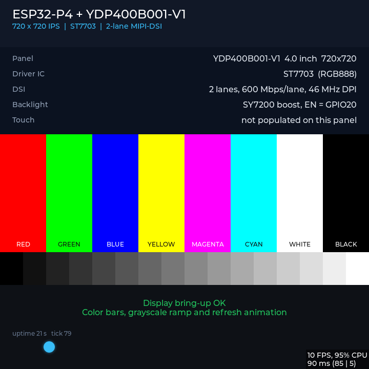

# ESP32-P4 Module + YDP400B001-V1 屏幕点亮

本工程用于在 **ESP32P4 模组基础底板 V1.5** 上点亮 **YDP400B001-V1 4.0 寸 720x720 IPS MIPI-DSI** 屏幕，并提供 LVGL 彩色条纹、灰阶和刷新动画用于快速验证。

## 说明

- 启动自检顺序：白底 400px LOGO 2 秒 → 全屏红/绿/蓝/白各 2 秒 → DSI 竖条 2 秒 → LVGL 测试界面（信息面板、彩条、灰阶、移动小球、uptime/tick，右下角 FPS/CPU 角标持续更新）。
- 最终 LVGL 界面截图：`images/lvgl-final-720x720.png`。
- 屏幕为 **不带触摸** 版本，本工程不初始化触摸 IC。
- 串口为底板 CH343P，端口以实际设备为准；下面示例使用 `COM22`。
- 屏幕通过转接板连接到底板 30P FPC，仅使用 2-lane MIPI：`D0P/N`、`D1P/N`、`CLKP/N`。
- 串口仅输出 `ESP_LOG` 文本日志，没有私有 COM 协议帧。
- 已知现象：快速全屏动画刷新时仍可能看到卷帘/撕裂感，当前版本尚未完全消除；静态画面和常规 UI 显示正常。

## 配置

| 项目 | 值 |
| --- | --- |
| 分辨率 | 720 x 720 |
| 驱动 IC | ST7703 |
| DSI | 2 lanes，600 Mbps/lane |
| DPI 时钟 | 46 MHz |
| 像素格式 | RGB888 |
| LVGL 色深 | 24 |
| HBP / HSA / HFP | 120 / 60 / 106 |
| VBP / VSA / VFP | 20 / 4 / 20 |
| DSI video mode | **burst + sync pulse（IDF 默认）** |
| `disable_lp` | 0 |
| `clock_lane_force_hs` | 0 |
| 防撕裂 | 2 帧缓冲 + full refresh + avoid_tearing，按 DSI VSYNC 切换（未使用 GPIO TE） |
| 刷新率 | 约 59.85 Hz |

## 硬件连接

> 底板 J3 丝印方向标反：丝印 30P 实际是物理 1P。以下按实际物理脚位。

| 功能 | 底板 J3 | ESP32-P4 | 备注 |
| --- | --- | --- | --- |
| LCD 复位 | 6 | GPIO5 | 经 R2 0R |
| LCD TE | 7 | GPIO4 | 经 R3 0R，GPIO 输入；示波器实测 16.6ms/约 60Hz 高脉冲 |
| 背光使能 | 8 | GPIO20 | 经 R1 0R，SY7200 升压 |
| DSI D0 | 10/11 | U4.38/39 | D0_P/N |
| DSI D1 | 13/14 | U4.34/35 | D1_P/N |
| DSI CLK | 16/17 | U4.37/36 | CLK_P/N |
| VCI | 4 | +3V3 | 屏模拟电源 |
| IOVCC | 5 | +3V3 | 屏 IO 电源 |
| LEDA | 1 | VLED+ | 背光 5 串 LED |
| LEDK | 2/3 | VLED- | 背光阴极 |
| 触摸 | 25–30 | - | 本屏不使用 |

## 工程结构

```text
main/
  main.cc                  应用入口
  AppInit/
    AppInit.cc             初始化流程
    lcd_init.cc            MIPI-DSI + ST7703 + LVGL
    DisplayTest.cc         彩色条纹/灰阶/刷新动画
    boot_logo.rgb          400x183 BGR888 开机 LOGO 资源
components/
  esp_lcd_st7703/          ST7703 MIPI-DSI 面板驱动
images/
  logo.png                 原始 LOGO
  lvgl-final-720x720.png   最终 LVGL 界面截图
```

## 依赖

- ESP-IDF **v6.1**（已验证版本，提交 `fff9895c82d7`）
- 更高版本理论上可用
- 构建前建议确认 `$IDF_PATH` 没有与本工程相关的本地修改；本工程不需要改 IDF 源码
- `lvgl/lvgl ^9.4.0`
- `espressif/esp_lvgl_port ^2.7.0`
- `espressif/esp_lcd_st7703` 已随工程放在 `components/esp_lcd_st7703`
- `dependencies.lock` 已包含在工程中，用于锁定组件版本

首次构建时 ESP-IDF Component Manager 会自动下载 `lvgl`、`esp_lvgl_port`、`cmake_utilities`。需要联网，或提前准备组件缓存。

## 构建与烧录

```powershell
. 'C:\Espressif\tools\Microsoft.v6.1.PowerShell_profile.ps1'
cd <工程目录>
idf.py set-target esp32p4
idf.py build
idf.py -p COM22 flash
```

查看日志：

```powershell
idf.py -p COM22 monitor
```

正常启动关键日志：

```text
LCD: MIPI DSI PHY LDO3 enabled at 2500 mV
LCD: DSI bus ready: 2 lanes, 600 Mbps/lane
LCD: ST7703 panel created
LCD: LVGL DSI tear-free: 2 frame buffers, full refresh, sync to panel VSYNC/TE (16.6ms)
LCD: LCD ready: 720x720, ST7703, 2-lane DSI, RST=GPIO5 BL=GPIO20 TE=GPIO4
DisplayTest: Display test UI created
AppInit: App ready, lcd_status=ready
```

## LVGL 界面截图


